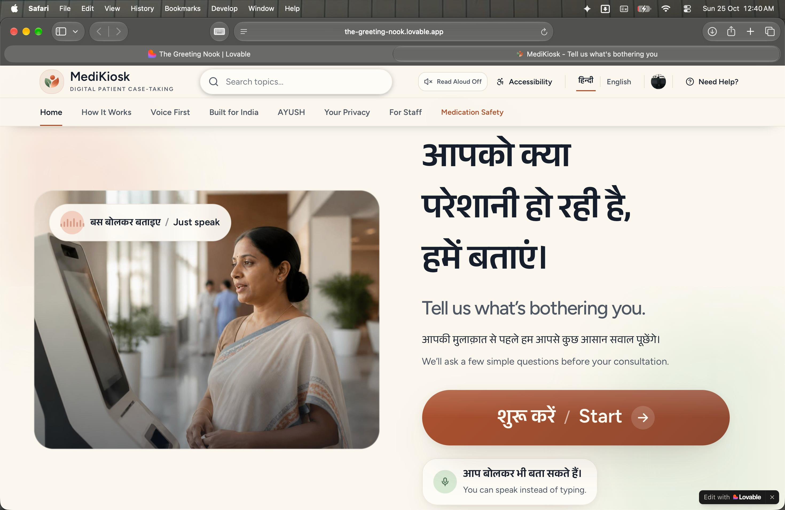
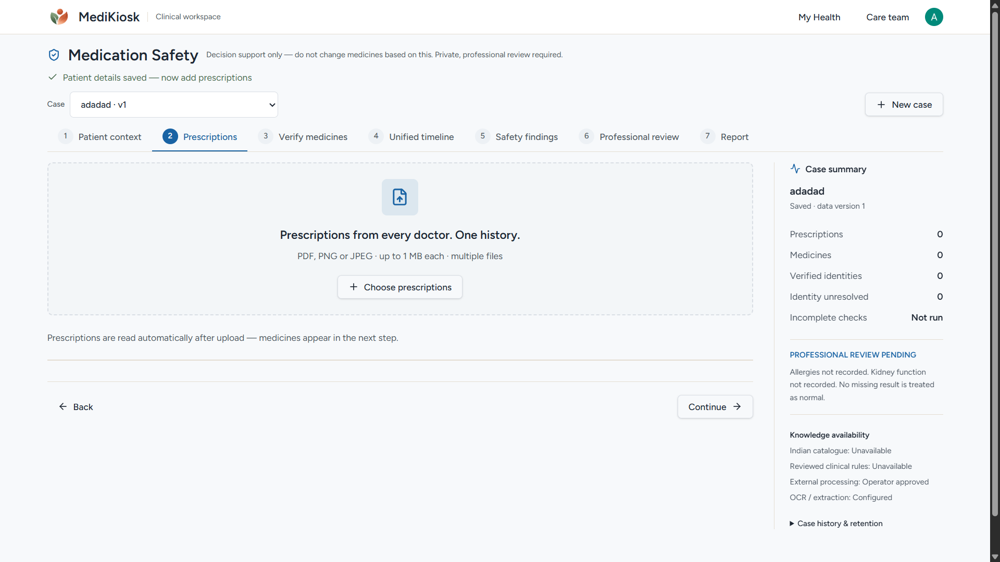
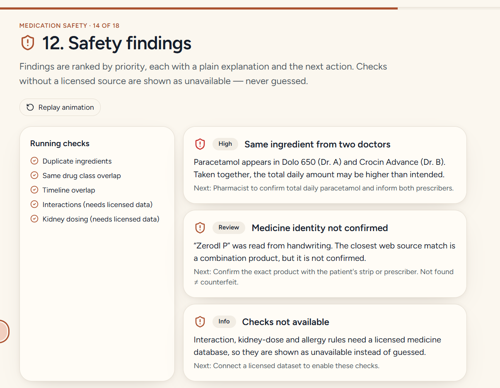
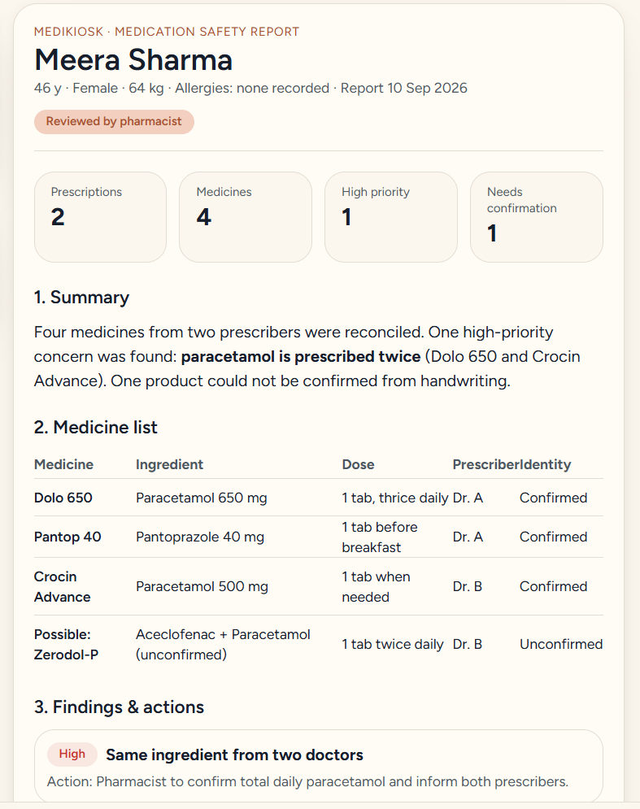

# MediKiosk

> **Voice-First, Multilingual Clinical Intake & Medication Safety Suite**  
> Built for high-volume outpatient clinics, hospitals, and community healthcare centers in India.

<p align="center">
  <a href="https://brijwasi-medikiosk.vercel.app/">
    
  </a>
  &nbsp;
  <a href="https://brijwasi-medikiosk.vercel.app/demo">
    
  </a>
  &nbsp;
  <a href="https://github.com/StrikerFr/Brijwasi-Medikiosk">
    
  </a>
  &nbsp;
  <a href="docs/JUDGES.md">
    
  </a>
</p>

<p align="center">
  <a href="https://brijwasi-medikiosk.vercel.app/patient-kiosk"></a>
  &nbsp;
  <a href="https://brijwasi-medikiosk.vercel.app/clinician"></a>
  &nbsp;
  <a href="https://brijwasi-medikiosk.vercel.app/medication-safety"></a>
  &nbsp;
  <a href="https://brijwasi-medikiosk.vercel.app/assisted-kiosk"></a>
  &nbsp;
  <a href="https://brijwasi-medikiosk.vercel.app/patient"></a>
  &nbsp;
  <a href="https://brijwasi-medikiosk.vercel.app/operations"></a>
</p>

<p align="center">
  <a href="https://www.typescriptlang.org/"></a>
  <a href="https://react.dev/"></a>
  <a href="https://tanstack.com/start"></a>
  <a href="https://ai.google.dev/"></a>
  <a href="https://groq.com/"></a>
  <a href="https://elevenlabs.io/"></a>
  <a href="https://turso.tech/"></a>
  <a href="https://clerk.com/"></a>
  <a href="https://vitest.dev/"></a>
</p>

---

## 📖 Table of Contents

- [Overview & The Problem](#-overview--the-problem)
- [Application Screenshots & Showcase](#-application-screenshots--showcase)
- [Live Evaluation for Judges](#-live-evaluation-for-judges)
- [System Architecture](#-system-architecture)
- [Key Features](#-key-features)
- [Quick Start](#-quick-start)
- [Deploying to Vercel](#-deploying-to-vercel)
- [Responsible AI & Clinical Governance](#-responsible-ai--clinical-governance)
- [Quality Assurance & Commands](#-quality-assurance--commands)
- [Documentation Directory](#-documentation-directory)

---

## 🩺 Overview & The Problem

In Indian Outpatient Departments (OPDs), doctors frequently consult 60 to 100+ patients in a single morning session, providing as little as 2 to 3 minutes per consultation. Patients face high literacy and language hurdles with conventional paperwork, while polypharmacy—taking uncoordinated prescriptions from multiple practitioners—leads to severe medical complications (e.g., compounding paracetamol dosages from different brand names like _Dolo 650_ and _Crocin Advance_).

**MediKiosk** transforms this experience through two complementary workflows:

1. **Patient Check-In Kiosk**: A walk-up, bilingual (Hindi & English) touch-and-voice interface that captures symptoms, vitals, and old medical documents without requiring patients to type.
2. **Medication Safety Reconciler**: A deterministic clinical engine that parses prescriptions across different doctors, maps Indian brand names to verified active pharmaceutical ingredients, and highlights timeline overlaps and dosage risks for professional sign-off.

---

## 📸 Application Screenshots & Showcase

### 1. Bilingual Voice-First Patient Intake Kiosk
> Walk-up touch and speech interface supporting natural spoken complaints in Hindi and English. Audio is transcribed in real-time via Groq Whisper and read aloud using ElevenLabs.



---

### 2. Clinical Workspace & Multi-Prescription Ingestion
> Healthcare provider dashboard allowing clinicians and pharmacists to upload multiple digital or handwritten prescriptions (PDF, PNG, JPEG) across past doctors into a single unified patient case.



---

### 3. Automated Safety Findings & Polypharmacy Overlap Detection
> Deterministic pharmaceutical reconciliation engine checks active ingredients against Indian pharmacopoeial rules, immediately detecting compound toxicities (e.g., duplicate Paracetamol in Dolo 650 and Crocin Advance).



---

### 4. Reconciled Medication Safety Report & Pharmacist Sign-Off
> Comprehensive clinical report consolidating verified molecules, dosage schedules, timeline overlaps, and actionable warnings ready for physician and pharmacist review.



---

## 🏆 Live Evaluation for Judges

A complete Judge & Evaluator Guide is available in [docs/JUDGES.md](docs/JUDGES.md).

| Surface | Direct Live Link | Local Route | Description |
| :--- | :--- | :--- | :--- |
| **Interactive Demo** | [Launch Guided Demo ↗](https://brijwasi-medikiosk.vercel.app/demo) | [`/demo`](https://brijwasi-medikiosk.vercel.app/demo) | 15-step animated product showcase walking through every feature with sample data. |
| **Patient Kiosk** | [Launch Patient Kiosk ↗](https://brijwasi-medikiosk.vercel.app/patient-kiosk) | [`/patient-kiosk`](https://brijwasi-medikiosk.vercel.app/patient-kiosk) | Real voice check-in, language toggle (Hindi/English), and token generation. |
| **Clinician Workspace** | [Open Clinician Worklist ↗](https://brijwasi-medikiosk.vercel.app/clinician) | [`/clinician`](https://brijwasi-medikiosk.vercel.app/clinician) | Doctor's worklist, prioritized queue, and structured patient case view. |
| **Medication Safety** | [Open Medication Safety ↗](https://brijwasi-medikiosk.vercel.app/medication-safety) | [`/medication-safety`](https://brijwasi-medikiosk.vercel.app/medication-safety) | Multi-prescription upload, OCR extraction, active ingredient matching, and PDF report generation. |
| **Assisted Intake** | [Open Assisted Intake ↗](https://brijwasi-medikiosk.vercel.app/assisted-kiosk) | [`/assisted-kiosk`](https://brijwasi-medikiosk.vercel.app/assisted-kiosk) | Receptionist interface for helping walk-in patients. |
| **Patient Health Portal** | [Open Patient Portal ↗](https://brijwasi-medikiosk.vercel.app/patient) | [`/patient`](https://brijwasi-medikiosk.vercel.app/patient) | Patient longitudinal timeline and intelligent health records assistant. |
| **Platform Telemetry** | [Open Operations Telemetry ↗](https://brijwasi-medikiosk.vercel.app/operations) | [`/operations`](https://brijwasi-medikiosk.vercel.app/operations) | System operations, dead-letter queue, and OCR/AI latency tracking. |
| **Administration** | [Open Admin Console ↗](https://brijwasi-medikiosk.vercel.app/admin) | [`/admin`](https://brijwasi-medikiosk.vercel.app/admin) | Facility administration, user management, and audit logs. |

---

## 🏗️ System Architecture

```
                                  [ Patient / Visitor ]
                                            │
                             ┌──────────────┴──────────────┐
                             │    Walk-up Kiosk Screen     │
                             │  (Hindi / English Voice UI) │
                             └──────────────┬──────────────┘
                                            │
                                  [ TanStack Start SSR ]
                                  [ Nitro Vercel Host  ]
                                            │
        ┌───────────────────────────────────┼───────────────────────────────────┐
        ▼                                   ▼                                   ▼
┌───────────────────────┐       ┌───────────────────────┐       ┌───────────────────────┐
│     Voice Intake      │       │      Clinical AI      │       │  Medication Safety    │
│ ───────────────────── │       │ ───────────────────── │       │ ───────────────────── │
│ • Groq Whisper (STT)  │       │ • Google Gemini 2.5   │       │ • OCR.space Document  │
│ • ElevenLabs (TTS)    │       │ • Chief Concern Extr. │       │ • Indian Brand Map    │
│ • Real-time Waveform  │       │ • Vitals Structuring  │       │ • Overlap Detection   │
└───────────┬───────────┘       └───────────┬───────────┘       └───────────┬───────────┘
            │                               │                               │
            └───────────────────────────────┼───────────────────────────────┘
                                            ▼
                               ┌─────────────────────────┐
                               │   Serverless Turso DB   │
                               │  (libSQL Cloud SQLite)  │
                               │  • Cases & Vitals       │
                               │  • Document Metadata    │
                               │  • Audit Trail Logs     │
                               └────────────┬────────────┘
                                            │
                        ┌───────────────────┴───────────────────┐
                        ▼                                       ▼
             ┌─────────────────────┐                 ┌─────────────────────┐
             │ Clinician Worklist  │                 │ Patient Health Home │
             │ • Prioritized Queue │                 │ • Visit History     │
             │ • Prepared Case     │                 │ • Diagnostic Vault  │
             │ • Professional Sign │                 │ • Groq Chat Helper  │
             └─────────────────────┘                 └─────────────────────┘
```

---

## ✨ Key Features

- **Voice-First Case Taking**: Natural conversational speech intake in Hindi and English. Audio is transcribed via Groq Whisper and read back using ElevenLabs spoken prompts.
- **Instant Clinical Structuring**: Clinical reasoning by Google Gemini 2.5 Flash extracts duration, symptom trajectory, triggers, and denied symptoms into standardized structured formats.
- **Document & Lab OCR**: Patients show diagnostic lab reports or prescriptions to the camera. Document types (e.g., CBC, Renal Function) are recognized and abnormal ranges are extracted automatically.
- **Indian Pharmaceutical Reconciler**: Handles complex Indian brand aliases and identifies duplicate molecules across prescriptions from different providers.
- **Care Team Handoff**: Triage priority is assigned automatically based on vitals, chief complaints, and urgent flags, reducing doctor preparation time from minutes to seconds.
- **Universal Accessibility**: High-contrast modes, large typography, bilingual audio guidance, and WCAG-compliant design tokens.

---

## 🚀 Quick Start

### Prerequisites

- **Node.js**: `22.x`
- **npm**: `10+`

### Setup

```bash
# 1. Install dependencies
npm ci

# 2. Configure environment
cp .env.example .env
# Populate API keys in .env

# 3. Validate configuration
npm run check:env

# 4. Run live API connectivity test
npm run check:apis

# 5. Start development server
npm run dev
```

---

## ☁️ Deploying to Vercel

This repository is optimized for deployment using Nitro's Vercel Build Output API:

1. Import this repository in the [Vercel Dashboard](https://vercel.com/new).
2. Set **Framework Preset**: `Other`.
3. Set **Build Command**: `npm run build`.
4. Set **Install Command**: `npm ci`.
5. **Output Directory**: Leave empty (Nitro outputs directly to `.vercel/output`).
6. Configure the Environment Variables for **Production** and **Preview** (see [docs/VERCEL.md](docs/VERCEL.md)).
7. Click **Deploy**.

For detailed deployment instructions and quota management, see [docs/VERCEL.md](docs/VERCEL.md).

---

## 🛡️ Responsible AI & Clinical Governance

- **Deterministic Pharmacological Matching**: Indian brand matching relies on explicit pharmacopoeial active ingredient mapping, not generative guesswork.
- **Human-in-the-Loop Verification**: Low-confidence brand matches are queued for pharmacist review. "Not found" never implies counterfeit.
- **Privacy & Consent Boundary**: External AI analysis requires recorded patient consent and operator privacy approval. Raw images and corrections maintain separate audit trails.
- **Zero Client Token Exposure**: All AI keys and database secrets are resolved server-side.

---

## 🧪 Quality Assurance & Commands

| Command                | Action                                                                    |
| :--------------------- | :------------------------------------------------------------------------ |
| `npm run check:apis`   | Test live connectivity to Gemini, Groq, Turso, Clerk, ElevenLabs, and OCR |
| `npx vitest run`       | Execute the full test suite (36 tests)                                    |
| `npm run typecheck`    | Strict TypeScript compiler validation (`tsc --noEmit`)                    |
| `npm run format:check` | Verify formatting consistency with Prettier                               |
| `npm run build`        | Compile the full production serverless bundle                             |

---

## 📚 Documentation Directory

- [Judge & Evaluator Guide](docs/JUDGES.md)
- [Architecture & Module Boundaries](docs/ARCHITECTURE.md)
- [Vercel Deployment Guide](docs/VERCEL.md)
- [Medication Safety Engine Documentation](docs/MEDICATION_SAFETY.md)
- [Route Conventions](src/routes/README.md)
